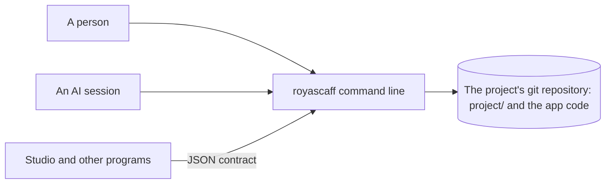

# Architecture

> **What:** the system on one page: context, apps, main parts, data flow and the rules between them
> **Read when:** designing any change, or finding where something belongs

Keep it short and current: link records (APP-, CMP-, ADR-, CTR-) instead of repeating them. A change whose Impact says "Architecture: changed" updates this page.

## 1. Context



## 2. Apps and runtimes

One app: APP-ENG-ENGINE (`engine/`), a Node package with no dependencies. It runs as a command line (`engine/bin`) on a person's machine, in CI or in a sandbox. The files in the repository are the only state.

## 3. Main parts

- CMP-ENG-002 · the command line entry (`engine/bin`): parses the call, runs one command, prints the contract envelope.
- CMP-ENG-001 · the engine library (`engine/lib`): the commands (`lib/commands`), the model that reads Markdown into records and links (`lib/model`, `lib/parse`, `lib/io`), derived status (`lib/derive`), the next action (`lib/next`), the board and other views (`lib/views`), migration from older engines (`lib/migrate`), and the gates, runner, fingerprints, judge and the other rules at the top of `lib`.
- CMP-ENG-003 · the adapters (`engine/adapters`): a card and a manifest per kind of product; the core runs what they declare.
- CMP-ENG-004 · the tests (`engine/tests`): fixtures, golden files and the contract suite.
- CMP-ENG-005 · the release scripts (`engine/scripts`): the safe deploy script. Never run by the engine.

## 4. Data flow

Markdown files in `project/` are read into records, links and events; status is computed from them and never typed. Commands write events to the logs and regenerate the board. Evidence carries a fingerprint of the code it covered. Git is the source of truth.

## 5. Dependency rules

- The library never imports the command line entry: `` `engine/lib/**` must not import `engine/bin/**` ``
- Nothing in the library imports the tests: `` `engine/lib/**` must not import `engine/tests/**` ``
- The core is generic: stack-specific behavior lives in adapters, not in the library.

## 6. Key decisions

ADR-ENG-001 · the engine is developed with itself, through a pinned copy.

## 7. Quality and operations

Every command keeps a valid JSON envelope, a schema and a golden file. The contamination guard and the token budgets stay green. `npm test` in `engine/` is the check; `npm run deploy` publishes, run only by the owner.

## Record format (example)

```md
## 1. Context

A Mermaid `flowchart LR`: Planner → Web app → API → Database; the API also calls the mail service.

## 5. Dependency rules

- Pages call the API client only; business rules live in the API services.
- `apps/web/src/pages/**` must not import `apps/web/src/db/**`: data reaches pages through the API client.
```
